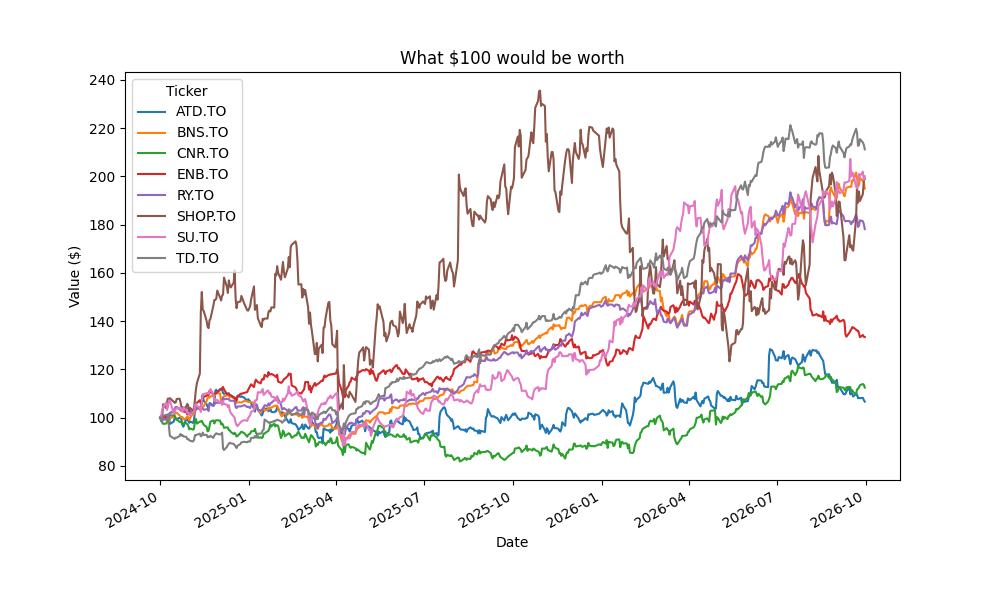

# Stock-Portfolio-tracker
Analyzes 2 years of daily prices for 8 TSX stocks to compare return, risk, and diversification.

Key findings
Best performer: TD (+111%)

Tools
Python, pandas, matplotlib, yfinance

How to run
pip3 install pandas matplotlib yfinance
Then open analysis.ipynb and run all cells.
